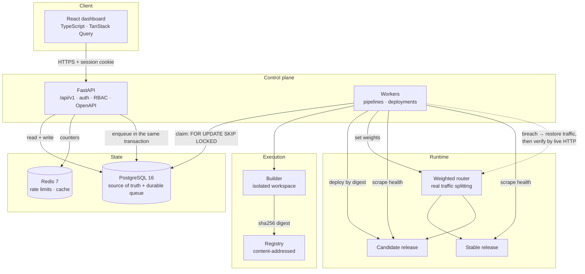
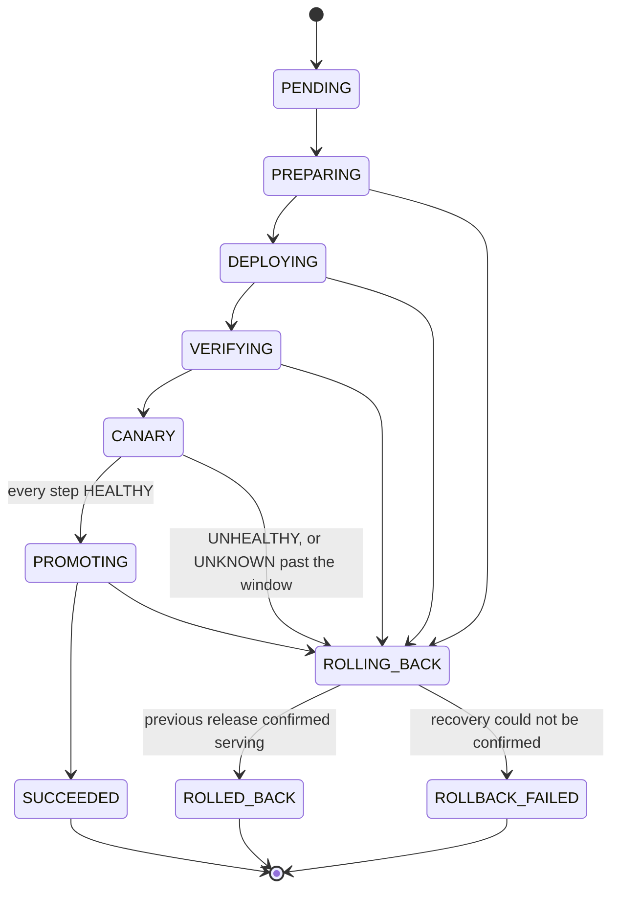

# Forge

A miniature internal developer platform. Forge connects a Git repository, builds
its source into an immutable artifact, deploys that artifact progressively,
measures the health of the new release against the old one, and **rolls back
automatically when a release misbehaves** — verifying that traffic actually
returned to the previous version before it calls the rollback done.

The defining demonstration runs locally in about a minute and needs no container
runtime, no cloud account and no network access:

```
▶ Scenario 1 — healthy release of v1.0.0
    ✓ CLONE     Checked out e4fc459c7efc on main.
    ✓ VALIDATE  Manifest valid: service sample-service, 2 check(s).
    ✓ TEST      2 check(s) passed.
    ✓ BUILD     Built sha256:f0085442ade3… (30720 bytes).
    ✓ SBOM      CycloneDX 1.5 SBOM with 3 component(s).
    - SCAN      No dependency scanner is installed (looked for trivy, grype, pip-audit).
    ✓ PUBLISH   Published forge.local/sample-service@sha256:f0085442ade3…
  ✓ all 40 requests served by v1.0.0

▶ Scenario 2 — faulty release of v1.1.0 must be rolled back
    canary_step           Shifted 10% of traffic to the candidate.
    health_evaluated      UNHEALTHY: error rate 45.45% exceeds ceiling 5.00%.
    rollback_started      Rolling back: Health thresholds breached…
    traffic_restored      All traffic routed back to the previous release 1.0.0.
    candidate_stopped     Candidate release was stopped.
    rollback_verification traffic served by 1.0.0 = True, stable health probe = True.
    rollback_finished     Traffic restored to the previous healthy release and verified.
  ✓ state: ROLLED_BACK
  ✓ rollback verified by post-rollback HTTP check: True
  ✓ all 40 requests served by the restored v1.0.0
  ✓ no requests reached the faulty candidate
```

Every line there is real: a real clone, real tests executing in a sandboxed
workspace, a real content-addressed artifact, real processes serving real HTTP
behind a real weighted proxy, and a rollback driven by measurements taken from
the running services.

---

## What makes this more than a status-field simulation

| Claim | How it is actually true |
| --- | --- |
| Traffic is really split | A weighted reverse proxy routes each request. At 10% the candidate serves exactly 10 of 100 requests, confirmed independently by client response headers, the proxy's counters and each backend's own counters. |
| Artifacts are immutable | Builds produce a reproducible tar with normalised metadata; identical source yields an identical `sha256`. Deployments resolve releases by digest only — there is no code path that deploys a mutable tag. |
| Health drives the decision | The analyser consumes request counts, error counts and latency percentiles scraped from the running release. A rollback happens because measurements breached a threshold, not because a test told it to. |
| Rollback is verified | After shifting weights back and stopping the candidate, Forge issues live HTTP requests and checks which version answers. `ROLLED_BACK` is written only if that passes; otherwise `ROLLBACK_FAILED`. |
| Unknown is never healthy | A candidate with too few samples, stale telemetry or no telemetry gets `UNKNOWN`, which never promotes. Silence cannot be mistaken for success. |
| State survives restarts | Pipelines, deployments, events, health samples and the job queue all live in PostgreSQL. Killing every process and restarting loses nothing. |

---

## Architecture



The rollout state machine, which is where the interesting behaviour lives:



`ROLLING_BACK` can only resolve to `ROLLED_BACK` or `ROLLBACK_FAILED`. There is no
transition that lets a rolled-back deployment report success.

Full detail: [`docs/architecture.md`](docs/architecture.md).

---

## Prerequisites

| Requirement | Version | Notes |
| --- | --- | --- |
| Python | 3.12 | 3.13 is not supported by every dependency yet |
| Node.js | 20+ | 22 recommended; only needed for the dashboard |
| git | any recent | used to check out repositories |
| A C compiler | any | used once, to build Redis from source |

**Not required:** Docker, Kubernetes, an AWS account, or a system PostgreSQL.
PostgreSQL 16 runs as an embedded server; Redis 7 is built from source on first
run. Both store data under `.forge/` and survive restarts.

---

## Quick start

```bash
# 1. Install
python3.12 -m venv .venv
make setup                      # Python deps, frontend deps, import check

# 2. Set a development administrator (there is no default password anywhere)
export FORGE_BOOTSTRAP_ADMIN_EMAIL=admin@forge.local
export FORGE_BOOTSTRAP_ADMIN_PASSWORD='choose-something-at-least-12-chars'

# 3. Start everything: PostgreSQL, Redis, router, API, worker
make up

# 4. Register the bundled demo repository
make seed

# 5. Run the demonstration
make demo
```

The dashboard is a separate command, because the platform is fully usable
without it:

```bash
make web      # http://127.0.0.1:5173
```

| Command | What it does |
| --- | --- |
| `make up` | Start the stack. Idempotent; never discards data. |
| `make down` | Stop services, keep all data. |
| `make status` | Show what is running. |
| `make logs` | Tail every service log. |
| `make clean` | Stop **and delete** all local data. Asks for `--yes`. |
| `make demo` | Healthy release, then faulty release and rollback. |
| `make demo-rollback` | Only the rollback scenario. |
| `make test` | The Python test suite. |
| `make check` | Everything CI runs on a pull request. |

---

## The demonstration

```bash
make demo
```

1. Builds the sample service at **v1.0.0** — clone, manifest validation, `ruff`
   and `pytest` inside a sandboxed workspace, a reproducible artifact, a CycloneDX
   SBOM, then publication.
2. Deploys it and confirms with 40 live requests that v1.0.0 is serving.
3. Commits **v1.1.0**, builds it (its tests pass — the fault is injected at deploy
   time, not hidden in the source).
4. Deploys v1.1.0 with `SAMPLE_ERROR_RATE=0.5`. The fault is explicit configuration
   and deterministic: one request in two fails, exactly.
5. At the first canary step, 10% of traffic reaches the candidate. Forge measures
   ~33 requests with ~15 errors, a 45% error rate against a 5% ceiling.
6. It aborts, restores traffic, stops the candidate, and **verifies by issuing
   live HTTP requests** that v1.0.0 is answering again.
7. It records `ROLLED_BACK` with `rollback_verified = true`, and raises an incident
   carrying the measurements that justified the decision.

Reproducible from any prior state: the demo pins its own starting version rather
than inheriting one. Full walkthrough and troubleshooting:
[`docs/demo.md`](docs/demo.md).

---

## Documentation

| Document | Contents |
| --- | --- |
| [architecture.md](docs/architecture.md) | Components, data flow, state machines, schema decisions |
| [security.md](docs/security.md) | Threat model, trust boundaries, build isolation, SSRF defences, limitations |
| [reliability.md](docs/reliability.md) | Leases, fencing, retries, locking, rollback semantics, failure modes |
| [api.md](docs/api.md) | Endpoint reference and worked examples |
| [development.md](docs/development.md) | Local setup, conventions, migrations, debugging |
| [deployment.md](docs/deployment.md) | Local, container and AWS paths, with status of each |
| [runbooks.md](docs/runbooks.md) | What to do when a worker, pipeline, deployment or rollback fails |
| [demo.md](docs/demo.md) | The demonstration, step by step |
| [adr/](docs/adr/) | Architectural decision records |

---

## Honest status

Forge is a **portfolio-scale platform demonstrating real delivery mechanics**. It
is not a hardened multi-tenant product, and this section exists so nobody has to
guess which parts are which.

### Verified by execution on the development host

- PostgreSQL 16.2 (embedded) and Redis 7.2.5 (built from source)
- Durable queue: 16 concurrent workers over 8 jobs produced exactly 8 unique claims
- Lease expiry, crash recovery and fencing of superseded workers
- Deployment locking: 12 racing acquirers produced exactly 1 winner
- Real pipeline execution including `ruff` and 9 `pytest` tests inside the sandbox
- Reproducible, content-addressed artifacts and CycloneDX SBOM generation
- Exact weighted traffic splitting at 10/25/50/100%, cross-checked three ways
- Health-driven rollback with post-rollback HTTP verification
- Canary promotion through every step on a healthy release
- 318 Python tests, 17 frontend unit tests, 22 Playwright tests
- `ruff`, `ruff format` and strict `mypy` clean across 76 source files

### Implemented but never executed here

These have no runtime available on this host. They are written against documented
interfaces and are clearly labelled in their own files:

- `BuildKitBuilder` — container image builds
- `DockerDeploymentAdapter` — container-based releases
- `EcrRegistry` — publishing to Amazon ECR
- `infra/compose/` — the Compose stack and its Dockerfiles
- `infra/terraform/` — the AWS stack (`terraform validate` in CI only)
- GitHub Actions workflows — valid YAML, never run on GitHub

### Known limitations

- **The process builder is not a kernel sandbox.** It isolates by workspace,
  scrubbed environment, POSIX resource limits and timeouts. It will not contain a
  determined attacker who controls repository contents. It refuses to run unless
  explicitly enabled. Containers are the real control.
- **SSRF protection is userspace.** Every resolved address is checked and
  re-checked before connecting, but a pure userspace check cannot fully close the
  TOCTOU window. Network-level egress policy is the proper defence.
- **Artifacts are not signed.** Signing is not configured, and Forge reports
  `signed: false` rather than implying verification it did not perform.
- **Dependency scanning is optional.** With no scanner installed the gate is
  recorded as `SKIPPED` with a reason — never as passed.
- **Private repositories are not supported.** Only public HTTPS, because
  authenticated checkout has not been implemented or tested.
- **Rate limiting degrades to per-process** without Redis, which is weaker across
  replicas. The `/ready` endpoint reports which backend is live.
- **The AWS path has never been applied.** Treat it as a reviewed design.

---

## Project layout

```
apps/
  api/             FastAPI control plane, operator CLI
  worker/          pipeline runner, deployment controller, builders, adapters
  router/          weighted reverse proxy (public + admin listeners)
  sample-service/  the application Forge builds and deploys
  web/             React dashboard
packages/
  forge-core/      domain model, state machines, ports, persistence, migrations
infra/
  compose/         container stack (unverified)
  terraform/       AWS stack (never applied)
tests/
  unit/            domain logic, no I/O
  integration/     against real PostgreSQL
  reliability/     crash, duplicate delivery, concurrency, restart
scripts/           stack control, demo, environment
docs/              architecture, security, reliability, operations, ADRs
```

## Licence

MIT.
