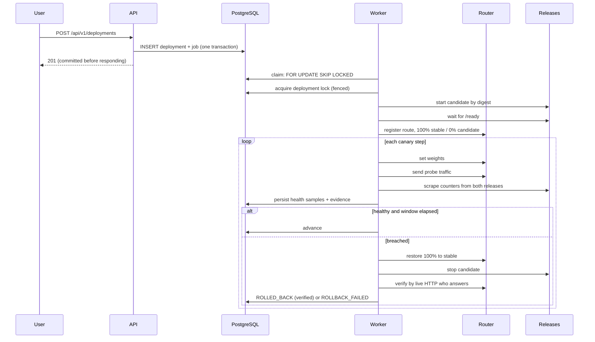

# Architecture

## Shape of the system

Forge is a modular monolith plus workers, not a constellation of microservices.
Four processes, each with a reason to exist separately:

| Process | Why it is its own process |
| --- | --- |
| **API** (`apps/api`) | Serves requests with predictable latency. Must not be blocked by a multi-minute build. |
| **Worker** (`apps/worker`) | Runs long, failure-prone work. Scales and restarts independently; its crashes must not take the API down. |
| **Router** (`apps/router`) | Sits in the data path of deployed applications. Its lifecycle is tied to the apps it serves, not to the control plane. |
| **Dashboard** (`apps/web`) | Static assets. No server-side rendering, so there is no third runtime to operate. |

Everything else is a module. There is no "pipeline service" or "artifact service",
because splitting them would add network calls and distributed-transaction
problems without buying independent scaling or failure isolation.

## Data flow



The ordering that matters: the API commits before responding, so a client that
creates a deployment and immediately polls it cannot miss its own write. The
worker persists health evidence *before* acting on it, so a rollback always
carries the measurements that caused it.

## Ports and adapters

Orchestration depends on interfaces, never on infrastructure:

| Port | Adapters | Status here |
| --- | --- | --- |
| `ArtifactBuilder` | `LocalProcessBuilder` | **verified by execution** |
| | `BuildKitBuilder` | implemented, never run (no container runtime) |
| `ArtifactRegistry` | `LocalContentAddressedRegistry` | **verified by execution** |
| | `EcrRegistry` | implemented, never run (no AWS account) |
| `DeploymentAdapter` | `ProcessDeploymentAdapter` | **verified by execution** |
| | `DockerDeploymentAdapter` | implemented, never run |
| `KeyValueStore` | `RedisRateLimiter` | **verified by execution** |
| | `InMemoryRateLimiter` | **verified by execution** (fallback) |

The canary logic, health analyser and rollback controller sit entirely above
these. Swapping `ProcessDeploymentAdapter` for `DockerDeploymentAdapter` changes
no orchestration code — that is the test of whether the boundary is real.

See [ADR 0001](adr/0001-environment-constrained-adapters.md).

## State machines

Transition legality is declared once, in `forge_core/state_machine.py`, and every
state change goes through `validate()`. The API, the worker and the tests cannot
drift apart because there is only one table.

### Pipeline

```
QUEUED → CLONING → VALIDATING → TESTING → BUILDING → PUBLISHING → SUCCEEDED
```

Every non-terminal state can reach `FAILED` or `CANCELED`. Nothing can skip a
stage, and nothing can move backwards.

### Deployment

```
PENDING → PREPARING → DEPLOYING → VERIFYING → CANARY → PROMOTING → SUCCEEDED
```

`ROLLING_BACK` is reachable from every state in which infrastructure may already
have been mutated — but **not** from `PENDING`, where nothing has happened yet and
there is nothing to roll back. It resolves only to `ROLLED_BACK` or
`ROLLBACK_FAILED`. There is deliberately no edge from `ROLLING_BACK` to
`SUCCEEDED`: a rolled-back deployment can never report success.

### Job

```
PENDING ⇄ RUNNING → SUCCEEDED
                  ↘ FAILED → PENDING (retry) | DEAD_LETTER
```

`RUNNING → PENDING` is the retry and lease-recovery path.

## The durable queue

The queue is in PostgreSQL, not Redis, for one reason: jobs drive deployments, so
losing a job means losing track of running infrastructure. Putting the queue in
the same transactional store as the state it mutates means a deployment row and
its job are committed together or not at all — there is no window where one
exists without the other.

Claiming:

```sql
WITH candidate AS (
    SELECT id FROM jobs
    WHERE state = 'PENDING' AND available_at <= :now
      AND cancel_requested = false AND kind = ANY(:kinds)
    ORDER BY priority ASC, available_at ASC
    FOR UPDATE SKIP LOCKED
    LIMIT 1
)
UPDATE jobs SET state = 'RUNNING', fence_token = fence_token + 1, ...
```

`SKIP LOCKED` means concurrent workers never block each other and never claim the
same row. Verified: 16 workers racing for 8 jobs produced exactly 8 unique claims.

Delivery is **at-least-once**. Exactly-once is not offered because it is not
achievable here, and claiming it would be a lie. The mechanisms that make
at-least-once safe:

- `dedupe_key` with a unique constraint — enqueuing the same logical work twice
  is a no-op, enforced by the database rather than by application checking
- leases and heartbeats — a dead worker's job returns to the queue
- `fence_token`, incremented on every claim — a resurrected worker holding a stale
  token is rejected before it can write
- handlers check their own terminal state first, so redelivery of finished work
  does nothing

## Schema decisions

| Decision | Reasoning |
| --- | --- |
| UUID primary keys | Identifiers can be minted client-side, are not enumerable, and do not leak volume. |
| Enum values as `String` + CHECK, not native `ENUM` | Adding a value needs no `ALTER TYPE`, so migrations stay non-blocking. |
| Logs in `log_chunks`, not inline | A long build would otherwise rewrite one ever-growing row, and the API can paginate without loading an entire build into memory. |
| `ON DELETE SET NULL` + denormalised `repository_label` | Deleting a repository must not erase the audit trail. History stays readable. |
| `deployment_locks` in PostgreSQL | A lock that can disagree with the state it guards is not a lock. |
| Partial index on runnable jobs | The claim query is the hot path; the index covers exactly it. |
| Health samples as rows, not aggregates | The evidence behind a rollback must be inspectable afterwards, not just its summary. |

## Transaction discipline

One rule, applied everywhere: **no database transaction is held open across a
build, a sleep, a health check or any network call.** Long work happens outside
transactions; each step commits on its own. This is why a 15-minute build does not
hold a connection, and why a controller crash leaves an accurate record rather
than a half-written one.

The API has a matching rule: mutating routes commit explicitly before returning,
rather than relying on dependency teardown. With `BaseHTTPMiddleware` installed the
response is streamed, and teardown can run after the client already has the
response — which produced real read-after-write failures before it was fixed.

## Forge's CI versus the CI Forge runs

Two different things that are easy to confuse:

| | Forge's own CI | Pipelines Forge runs |
| --- | --- | --- |
| Where | GitHub Actions (`.github/workflows/`) | Forge's workers, on your infrastructure |
| What | Lints, types and tests *Forge itself* | Builds and deploys *your applications* |
| Defined by | Workflow YAML | `forge.toml` in the application repository |
| Trust | Runs trusted first-party code | Runs **untrusted** repository code, sandboxed |

The security posture differs because the trust level differs. See
[security.md](security.md).
