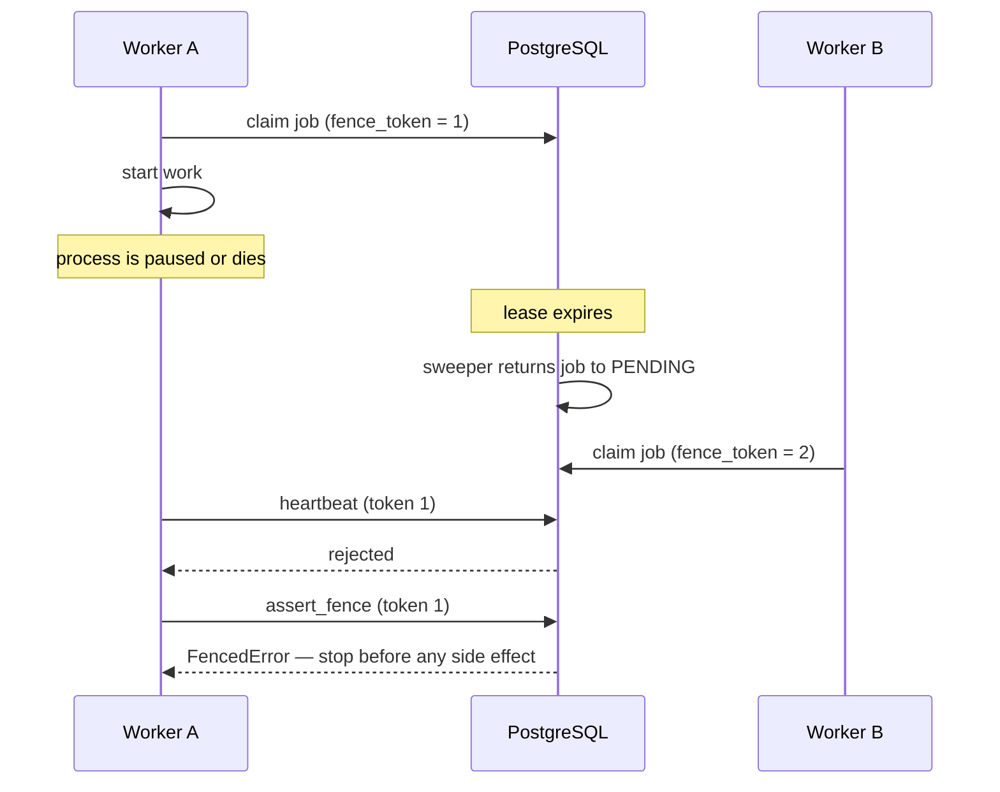
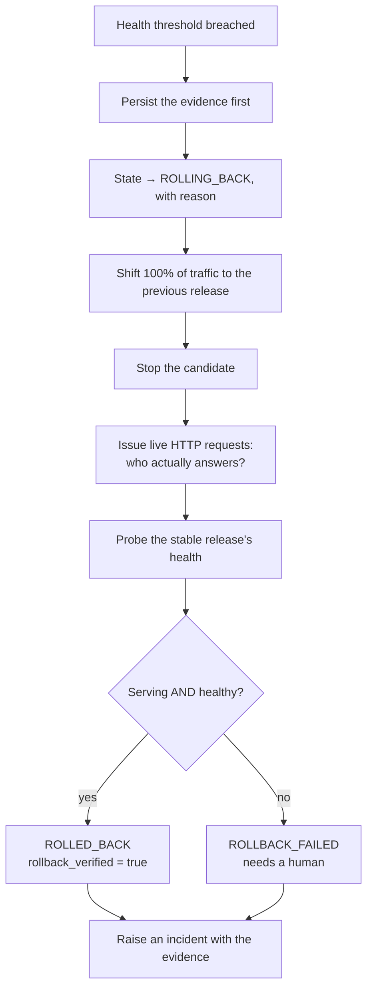

# Reliability

How Forge behaves when things go wrong, and why it behaves that way.

## Delivery guarantees

Forge offers **at-least-once** job execution. It does not offer exactly-once,
because exactly-once is not achievable across a process boundary and claiming it
would be dishonest.

What that means in practice: a handler may run more than once for the same logical
job. Handlers are written accordingly — each checks its own terminal state first
and returns immediately if the work is already finished.

## The queue

```sql
WITH candidate AS (
    SELECT id FROM jobs
    WHERE state = 'PENDING' AND available_at <= :now
      AND cancel_requested = false AND kind = ANY(:kinds)
    ORDER BY priority ASC, available_at ASC
    FOR UPDATE SKIP LOCKED
    LIMIT 1
)
UPDATE jobs SET state='RUNNING', fence_token = fence_token + 1, ...
```

| Mechanism | Purpose | Verified by |
| --- | --- | --- |
| `FOR UPDATE SKIP LOCKED` | Concurrent workers never block and never double-claim | 16 workers / 8 jobs → exactly 8 unique claims |
| `dedupe_key` unique constraint | Enqueuing the same work twice is a no-op, enforced by the database | 10 concurrent enqueues → 1 row |
| Transactional enqueue | A job cannot exist without the row that justifies it | Rolled-back caller leaves no orphan job |
| Lease + heartbeat | A dead worker's job returns to the queue | Expired lease reclaimed, attempt counted |
| `fence_token` | A resurrected worker cannot write under stale authority | Stale `assert_fence` and `heartbeat` both rejected |
| Bounded attempts | A poison job dead-letters instead of looping | Retry → retry → `DEAD_LETTER` |

### Why PostgreSQL and not Redis

Jobs drive deployments. Losing a job means losing track of running infrastructure.
Keeping the queue in the same transactional store as the state it mutates means a
deployment row and its job commit together or not at all. With a separate broker
there is always a window where one exists without the other, and the recovery code
for that window is where the bugs live.

Redis is used for rate-limit counters and caching — data whose loss costs
throughput, not correctness.

## Retry and backoff

Exponential backoff with **full jitter**: `uniform(0, min(base · 2^(n-1), cap))`.

Full jitter rather than equal jitter because many workers poll the same queue.
After a shared dependency recovers, equal jitter still leaves a synchronised
burst; full jitter spreads retries uniformly. The exponent is clamped before the
power, so a runaway attempt count cannot overflow.

Builds are enqueued with `max_attempts=1`. A failed build is a *result*, not a
transient fault — retrying it automatically would burn minutes of compute to
produce the same failure, and would hide a genuine problem behind a retry count.

## Leases and fencing



This is the classic "paused process wakes up and clobbers" failure. The fence
check runs **before** any externally visible side effect, so a worker that was
presumed dead stops rather than writing.

The same pattern protects deployment locks: `assert_held_in` is called at every
canary step, so a controller that lost its lease stops before changing traffic
weights.

## Deployment locking

Two deployments must never mutate the same service and environment concurrently —
they would fight over traffic weights.

Three layers:

1. **API** rejects a second deployment while one is active (`409`). Fast feedback.
2. **Database lock** on `(service, environment)`, acquired by the worker. The real
   guard, verified: 12 racing acquirers → exactly 1 winner.
3. **Fence tokens** on the lock, so an expired holder is rejected even if it wakes.

An expired lock is reclaimable — otherwise a crashed controller would block the
service forever — and the token increments on takeover, fencing the old holder.

## Rollback semantics

This is the part most worth getting right, so it is worth stating precisely.



Three properties worth naming:

1. **Evidence is persisted before acting on it.** The measurements that justified
   a rollback are exactly what an operator needs afterwards. Storing them after
   the abort decision meant they were missing from precisely the deployments that
   rolled back — a bug this project had and fixed.
2. **`ROLLED_BACK` requires verification.** Forge sends real requests through the
   router and checks which version answers, and probes the restored release's
   health. If either fails, the state is `ROLLBACK_FAILED` — a distinct state,
   styled distinctly in the dashboard, because it needs a human.
3. **No rollback target is reported honestly.** If a service has no previous
   healthy release, Forge records that it could not restore traffic rather than
   implying it did.

## Health gating

| Situation | Verdict | Effect |
| --- | --- | --- |
| No telemetry | `UNKNOWN` | Hold, then abort when the window expires |
| Fewer than `min_samples` requests | `UNKNOWN` | Hold, then abort |
| All samples stale | `UNKNOWN` | Hold, then abort |
| Liveness or readiness probe failing | `UNHEALTHY` | Abort immediately, regardless of sample count |
| Error rate or p95 above ceiling | `UNHEALTHY` | Abort immediately |
| Large regression against stable | `UNHEALTHY` | Abort immediately |
| Within thresholds, window elapsed | `HEALTHY` | Advance or promote |

**`UNKNOWN` never promotes.** A silent candidate cannot be mistaken for a healthy
one. It also cannot stall a rollout forever: once the observation window expires
without a verdict, Forge aborts.

Two related subtleties:

- *0/0 is not a 0% error rate.* Zero errors out of zero requests says nothing
  about health, so it yields `UNKNOWN`, not `HEALTHY`.
- *Probe failures bypass the sample minimum.* A service reporting "I am not ready"
  is a direct statement that needs no statistical support.

### Probe volume scales with weight

At a 10% canary, only a tenth of requests reach the candidate. A fixed probe count
leaves it below `min_samples`, so every verdict is `UNKNOWN` and every rollout
aborts for the wrong reason — which is exactly what happened before this was
fixed. Probe volume is now `min_samples / weight × safety factor`, bounded, so the
candidate always clears the threshold and a real breach is reported as a real
breach.

## Failure modes

| Failure | Behaviour | Tested |
| --- | --- | --- |
| Worker killed mid-job | Lease lapses, sweeper requeues, another worker picks it up | ✅ |
| Worker resurrects after takeover | Fenced out of heartbeat and side effects | ✅ |
| Duplicate job enqueue | Unique constraint collapses it to one | ✅ |
| Redelivery of finished work | Handler returns the terminal state, does nothing | ✅ |
| Two deployments race | Exactly one wins; the other is deferred or rejected | ✅ |
| Controller dies mid-rollout | Deployment stays in its last persisted state; the lock expires and recovery can proceed | ✅ (state persistence) |
| Candidate never becomes ready | Aborted before any traffic is sent | ✅ (demo path) |
| Candidate returns errors | Detected at the first canary step, rolled back, verified | ✅ |
| No telemetry from candidate | `UNKNOWN` → abort, never promote | ✅ |
| Rollback verification fails | `ROLLBACK_FAILED`, incident raised | ✅ (unit level) |
| Repeated cancellation | Idempotent; a finished job is unaffected | ✅ |
| Stack restarted | All history and pending jobs survive | ✅ |
| Redis unavailable | Rate limiting degrades to per-process and logs it; the API stays up | ✅ |
| Database unavailable | `/ready` returns 503 so a load balancer drains the node; `/health` still reports the process alive | ✅ |

## Observability

- **Structured JSON logs** with request, correlation, pipeline, deployment and job
  ids bound to the context, so one trace can be followed across processes.
- **Prometheus metrics** at `/metrics`: HTTP counts and latency histograms by
  *route template* (never the concrete path, which would explode cardinality),
  queue depth by state, job durations and failures, deployment outcomes and
  rollback counts.
- **Durable event timelines** per deployment, ordered and gap-free.
- **Incidents** created automatically on rollback, carrying the evidence.
- **Audit events** for every security-sensitive operation, including failures —
  a failed login is recorded, which is the case that matters during an incident.

## Operational limits

- Single-region, single-writer PostgreSQL. No sharding, no read replicas.
- The router holds its table in memory. On restart it comes up empty and the
  controller reasserts it — authority flows from the database outward, which is
  the right direction, but a router restart mid-rollout needs the controller to
  re-register the route.
- No distributed tracing backend is wired up; OpenTelemetry instrumentation is
  present but disabled by default.
- The recovery sweeper runs every 10 seconds, so worst-case recovery latency is
  roughly the lease duration plus that interval.
