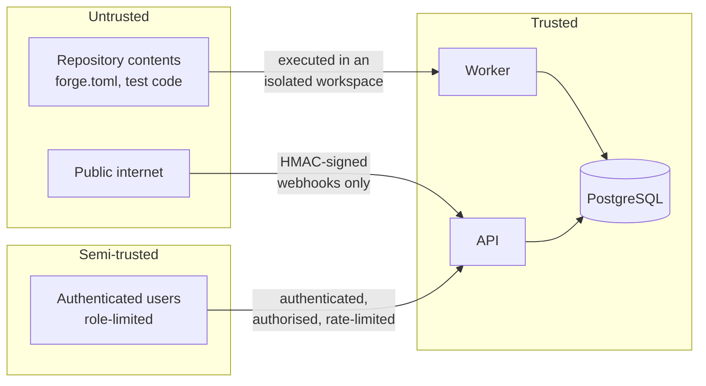

# Security

This document is written to be useful to someone deciding whether to trust Forge
with something. It states what is defended, how, and — equally important — what
is not.

## Trust boundaries



The sharpest boundary is the first one: **repository contents are untrusted code
that Forge deliberately executes.** Everything in the build path is designed
around that.

## Threat model

| Threat | Control | Residual risk |
| --- | --- | --- |
| Malicious repository runs arbitrary commands | Manifest commands are argv vectors with an executable allowlist; no shell is involved | A permitted tool (`python`, `npm`) can still run arbitrary code — this is inherent to running builds |
| Build escapes to the host | Workspace isolation, scrubbed environment, POSIX rlimits, process-group kill, timeouts | **Not a kernel sandbox.** Containers are the real control |
| Build exfiltrates credentials | No credentials are placed in the build environment at all; PATH and env are constructed, not inherited | A build can still reach the network |
| SSRF via repository URL | Scheme allowlist, credential rejection, blocked ranges, every resolved address checked and re-checked before connect | TOCTOU window cannot be fully closed in userspace |
| Credential theft from the database | Argon2id hashing; no plaintext anywhere | Offline attack on a stolen hash, bounded by Argon2 cost |
| Session hijacking | HttpOnly + SameSite cookies, server-side revocation checked per request, short TTL | XSS could still act as the user within the session |
| CSRF | Double-submit token required for cookie-authenticated writes | — |
| Forged webhooks | HMAC-SHA256 over the raw body, verified before parsing; unset secret disables the endpoint | — |
| Replayed webhooks | Delivery id recorded with a unique constraint | — |
| Privilege escalation | Server-side permission check on every route; UI hiding is cosmetic | — |
| Brute-force login | Rate limiting plus account lockout after repeated failures | Distributed attacks need network-level controls |
| Account enumeration | One message for every failure mode; timing equalised against a dummy hash | — |
| Secret leakage via logs | Redaction on logs, stored job errors and build output | Best-effort pattern matching, not a guarantee |
| Secret leakage via API | Explicit response schemas; ORM objects never serialised directly | — |

## Build isolation — read this before trusting it

`LocalProcessBuilder` applies:

- a dedicated workspace directory, deleted afterwards
- a **constructed** environment: only `LANG`, `LC_ALL`, `TZ` pass through, plus an
  explicit `PATH` and a throwaway `HOME`. No Forge configuration, no database URL,
  no secrets
- a new process group, so a timeout kills the whole tree rather than one process
- POSIX resource limits: `RLIMIT_AS`, `RLIMIT_CPU`, `RLIMIT_NPROC`, `RLIMIT_FSIZE`,
  and `RLIMIT_CORE=0`
- a wall-clock timeout and a bounded output buffer
- `.git` removed after checkout, so a malicious manifest cannot use git tooling to
  reach the network or read a credential helper

**It is not a kernel sandbox.** There is no namespace isolation, no seccomp filter
and no network isolation. It raises the cost of accidental and casual misuse; it
does not contain a determined attacker who controls repository contents.

Because that is true, the builder **refuses to run** unless
`FORGE_ALLOW_UNSANDBOXED_BUILDS=true` is set explicitly. The weaker mode cannot be
entered by accident, and the dashboard shows whether it is active.

The production control is `BuildKitBuilder`, which builds in containers. Note what
it deliberately does *not* do: it talks to a BuildKit daemon over its own address
and **never receives the host container socket**. Repository code therefore cannot
reach the host daemon.

### Container runtime access is host-equivalent privilege

Anything that can talk to a container runtime socket can start a privileged
container mounting the host filesystem. That is root. Consequences:

- the **build** worker never gets runtime access — it uses BuildKit over its own
  endpoint
- only the **deployment** adapter needs it, and its job is narrow: start, stop and
  inspect releases
- in `infra/compose/docker-compose.yml`, the socket mount is on the worker and is
  the single most dangerous line in the file. It is commented as such. Use
  `FORGE_DEPLOY_ADAPTER=process` to avoid it

## SSRF defence in detail

A user-supplied repository URL is a classic confused-deputy vector. Forge
(`forge_core/urlguard.py`) rejects:

- any scheme but `https` — no `http`, `file`, `git`, `ssh`, `gopher`
- URLs embedding credentials
- whitespace, control characters and over-long URLs
- `localhost`, `*.localhost`, `*.local`, `metadata.google.internal`
- literal addresses in loopback, RFC1918, CGNAT, link-local (including
  `169.254.169.254`), multicast, reserved and documentation ranges
- IPv4-mapped IPv6 (`::ffff:127.0.0.1`) and 6to4-encapsulated private addresses —
  loopback wearing a costume
- hostnames where **any** resolved address falls in a blocked range, so a name
  resolving to both a public and a private address is refused

Addresses are re-validated immediately before connecting, which narrows the DNS
rebinding window. It does not eliminate it: a pure userspace check cannot. **The
production control is a network-level egress policy** restricting what the build
network may reach. The Terraform stack does not configure one, and says so.

Covered by 30 unit tests and 7 live API tests.

## Authentication and authorisation

- **Argon2id** password hashing with the library defaults, which track OWASP
  guidance. `needs_rehash` is checked on every successful login, so parameters can
  be raised later without forcing a reset.
- Password length is bounded at both ends — unbounded input would make hashing
  itself a denial-of-service vector.
- **JWT sessions** carrying a `jti`, checked against a server-side `sessions` table
  on every request. Revocation therefore takes effect immediately, which a
  stateless token alone cannot do.
- **Cookies**: `HttpOnly` (not readable by JavaScript), `SameSite=Lax`, and
  `Secure` outside development.
- **CSRF**: cookie-authenticated unsafe methods require a double-submit token.
  Bearer clients are exempt because they are not subject to ambient credentials.
- **Lockout** after repeated failures, bounding online guessing independently of
  the IP-based rate limit.

Roles are strictly nested: `VIEWER ⊂ DEVELOPER ⊂ ADMIN`. Every protected route
depends on `require(permission)` and fails closed. The dashboard hides controls a
user cannot use — that is a usability affordance, and the Settings page says so
explicitly so nobody mistakes it for a security boundary.

### The bootstrap administrator

A fresh stack has no users. Forge can create one from
`FORGE_BOOTSTRAP_ADMIN_EMAIL` / `FORGE_BOOTSTRAP_ADMIN_PASSWORD`, constrained so it
cannot become a production backdoor:

- both variables must be set; neither has a default
- **there is no built-in default password anywhere in the codebase**
- `Settings` raises at startup if they are set outside development
- an existing user is never silently overwritten
- creation is logged at warning level

Outside development, use `python -m forge_api.cli create-user`.

## Secret handling

Secrets live in environment variables, never in code, images or version control.
`.env` is gitignored; `.env.example` holds placeholders only, and CI runs a secret
scanner over full history.

Redaction (`forge_core/redaction.py`) masks credential-shaped content in logs,
stored job errors and build output: URL userinfo, bearer tokens, `key=value`
assignments with credential-like names, PEM private key blocks, JWTs, GitHub
tokens and AWS access key ids. It is applied recursively to structured payloads.

**Redaction is defence in depth, not the primary control.** The primary control is
that secrets are never placed in the build environment to begin with. Pattern
matching will miss novel formats.

The API never returns secret values. `/api/v1/admin/settings` reports *whether*
each secret is configured — `webhook_secret_configured: true` — and an e2e test
asserts no secret value appears in the rendered page.

## Supply chain

| Control | Status |
| --- | --- |
| Immutable, content-addressed artifacts | **Implemented and verified.** Reproducible digests; deployment by digest only |
| Provenance recorded | **Implemented.** Repository, commit, pipeline run, builder, timestamps |
| SBOM | **Implemented.** CycloneDX 1.5, downloadable |
| Dependency scanning | **Optional.** Looks for `trivy`, `grype`, `pip-audit`; absent → `SKIPPED` with a reason |
| Artifact signing | **Not configured.** Reported as `signed: false` |
| CI dependency audit | `pip-audit` and `npm audit` on every pull request |
| Image scanning | Trivy in the release workflow (never executed) |
| Pinned actions | Third-party actions pinned to commit SHAs |

A skipped gate is never reported as a pass. The dashboard shows `SKIPPED` with the
reason, and the Security page explains how to enable it.

## HTTP hardening

Applied to every response:

```
X-Content-Type-Options: nosniff
X-Frame-Options: DENY
Referrer-Policy: no-referrer
Cross-Origin-Opener-Policy: same-origin
Cross-Origin-Resource-Policy: same-site
Permissions-Policy: geolocation=(), microphone=(), camera=(), payment=()
Content-Security-Policy: default-src 'none'; frame-ancestors 'none'; base-uri 'none'; form-action 'none'
Cache-Control: no-store
```

The CSP is restrictive because the API serves JSON only. CORS uses an explicit
origin list; a wildcard is refused outside development, and would be invalid
anyway with credentials enabled.

Error responses never carry stack traces, SQL or internal paths. An unexpected
error returns an opaque message plus a request id, which is the handle an operator
uses to find the full detail server-side.

## What is not defended

Stated plainly, because a security document that only lists strengths is not
useful:

1. **No kernel-level build sandbox** in the process builder.
2. **No network egress filtering** for builds. The SSRF guard controls what Forge
   connects to, not what build commands connect to.
3. **No multi-tenancy.** Any authenticated user with the right role sees all
   repositories and deployments. There is no per-tenant isolation.
4. **No artifact signing.**
5. **No secret rotation.** Changing `FORGE_SECRET_KEY` invalidates all sessions.
6. **No audit log tamper-evidence.** Append-only by convention; a database
   administrator could alter it.
7. **No DDoS protection.** Rate limiting is per-IP abuse control, not volumetric
   defence.
8. **Private repositories are unsupported.** Not claimed, not implemented.
9. **The AWS configuration has never been applied.** Its IAM policies are
   unverified against real API calls.

## Reporting

This is a portfolio project, not a maintained product. If you are reading it as a
reference, the files worth reviewing are `forge_core/urlguard.py`,
`forge_core/redaction.py`, `forge_worker/builders/sandbox.py` and
`forge_api/deps.py`.
